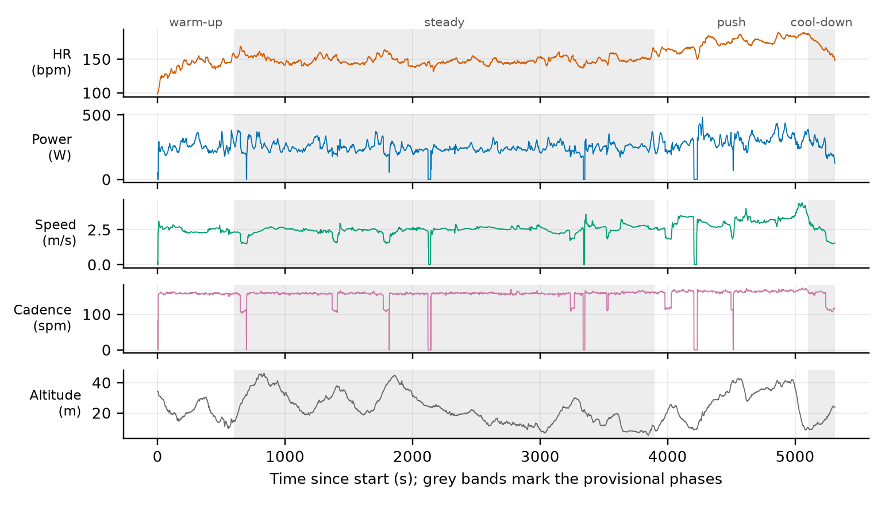
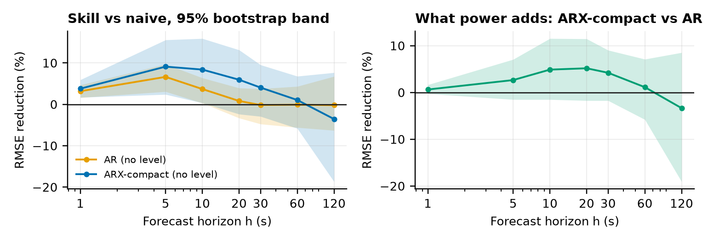

# Forecasting heart rate in a run

Can running power help predict where your heart rate is heading? This project forecasts heart rate (HR) 1–120 seconds ahead during a single 88-minute run recorded with a Garmin Forerunner 255. It compares naïve baselines, autoregressive (AR) models, AR models with running power as an exogenous input (ARX), and a physiological state-space model fitted with a Kalman filter.

Course project for *ISM-E1005 Forecasting Methods in Business Analytics*. The full write-up is in [report.pdf](report.pdf).



## Key findings

- **The naïve forecast ("HR stays the same") is hard to beat.** At one sample per second HR is very smooth, so the last value is already a strong forecast.
- **The best model (ARX-compact, no HR level) beats the naïve forecast by 3.8–9.1% at 1–5 s and 8.4% at 10 s** (RMSE skill). Averaged over 1–60 s, its skill is 5.4%. In absolute terms these are fractions of a bpm: at 10 s the RMSE drops from 2.66 to 2.44 bpm.
- **Running power helps most at 5–30 s horizons**, and mainly during the high-effort "push" at the end of the run. Block-bootstrap intervals for the gain over HR-only models include zero, so part of the improvement could be noise.
- **No model reliably beats naïve at 60 s or longer.** Future power is unknown, and the power–HR relationship drifts during the run (fatigue, heat). A state-space model given the *true* future power reached 7–8% skill at 60–120 s, which suggests that forecasting power is the main bottleneck.
- HR responds to a sustained change in power with a delay: it reaches 63% of the final effect after about 50 s and settles at roughly 0.17 bpm per watt.



## Method in brief

- **Target:** the change in HR over horizon *h* ∈ {1, 5, 10, 20, 30, 60, 120} s, with one direct regression per horizon.
- **Models:** naïve, Mean-30 and Drift-30 baselines; AR on recent HR changes; ARX that adds raw and exponentially smoothed (EWMA) running power; and a state-space model in which latent HR relaxes toward a power-driven target with an optional drifting offset.
- **Evaluation:** rolling-origin, fully out-of-sample, starting at 1,200 s and refitting every 60 s. Accuracy is measured as RMSE skill relative to naïve. Differences are checked with Diebold–Mariano tests (HAC errors), a 200 s moving-block bootstrap, comparisons across time blocks, and 11 alternative design choices.

See Sections 3–5 of the [report](report.pdf) for details and limitations.

## Repository contents

| File | Description |
|---|---|
| [hr_forecasting_master.ipynb](hr_forecasting_master.ipynb) | Main notebook. It runs the whole analysis from the raw CSV to every figure and table in the report. |
| [hrlib.py](hrlib.py) | Shared helpers: feature construction, ridge fitting, rolling-origin forecasts, Diebold–Mariano test, block bootstrap. |
| [hrss.py](hrss.py) | `HRStateSpace`, the physiological state-space model (a `statsmodels` `MLEModel`). |
| [run_2026-04-26.csv](run_2026-04-26.csv) | The data: 5,313 one-second observations. |
| [report_figs/](report_figs/) | Figures generated by the notebook and used in the report. |
| [report.pdf](report.pdf) | Project report. |

### Data

`run_2026-04-26.csv` has one row per second with these columns:

| Column | Unit | Description |
|---|---|---|
| `t` | s | Time since start |
| `hr` | bpm | Heart rate (optical wrist sensor) |
| `speed` | m/s | Speed |
| `power` | W | Running power (estimated by the watch) |
| `cadence_spm` | steps/min | Cadence |
| `altitude` | m | Altitude |
| `distance` | m | Cumulative distance |

The file has no gaps or missing values. It contains no GPS coordinates.

## Running it

Requires Python 3.10 or later.

```bash
git clone https://github.com/nooavon/Forecasting-heart-rate-in-a-run.git
cd Forecasting-heart-rate-in-a-run
python -m venv .venv
source .venv/bin/activate        # Windows: .venv\Scripts\activate
pip install -r requirements.txt
jupyter lab hr_forecasting_master.ipynb
```

Run the notebook top to bottom (*Restart & Run All*). The notebook is split into five self-contained parts:

1. Data preparation, power→HR lag structure, causal smoothing
2. Baselines, AR and ARX models, rolling-origin evaluation
3. Robustness: bootstrap, time blocks, sensitivity grid
4. Physiological state-space (Kalman) model
5. Report figures, written to `report_figs/`

The notebook expects `hrlib.py`, `hrss.py` and the CSV in the same folder. The state-space part re-estimates the model many times, so a full run takes a while.

## Limitations

All results come from **one run by one person**. Some model variants were chosen after looking at test errors, so the best model's scores are likely somewhat optimistic. Read the findings as a case study, not a general result. The report's Section 5.5 covers this in more detail.

## License

The code is released under the [MIT License](LICENSE).
